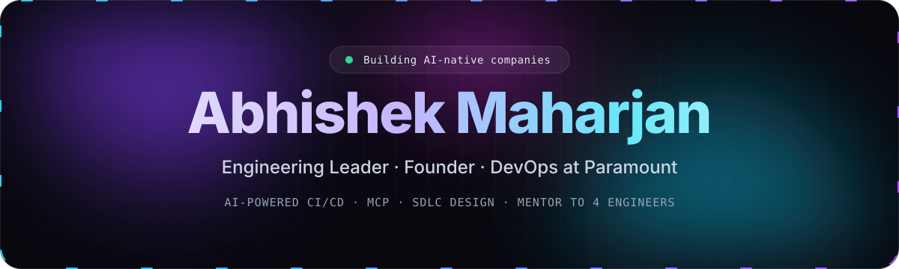
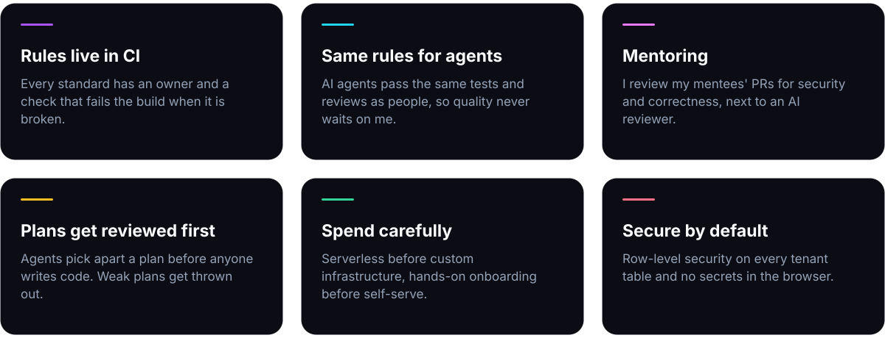

  

## About

I'm an engineering leader with a founder's mindset. My job isn't to write the most code. It's to decide what's worth building, set the bar, and build the systems and teams that ship fast without breaking things.

I've worn every hat in the software lifecycle: QA, developer on the release engineering side, DevOps, architecture and now leadership. That's why designing SDLC processes is my specialty. I know how work gets planned, tested, reviewed, released and run, because I've owned each of those steps myself, and I design processes that teams actually follow.

By day I work on the delivery platform at **Paramount**, where I build AI-powered CI/CD pipelines and MCP servers that connect AI agents to our engineering systems, so software ships at media scale with AI doing work engineers used to do by hand. By night I lead engineering for products the Nepali community in America runs on: restaurants take orders and dispatch couriers through them, street fairs and concerts sell their tickets through them, and a cultural organization raises its donations through them.

I also mentor four engineers, growing them into the people who own what we build.

My teams are people and AI agents across Claude, OpenAI and Gemini. One plans, one writes the failing tests, fast models implement, and the strongest model reviews anything that touches money, auth or customer data. When the cloud isn't the right answer, models run locally on my own GPU server with Ollama.

## How I lead

## What I'm building

## Open source

DevOps tools for the failures that still eat engineer hours.

| Project | What it does |
|---|---|
| [ai-pipeline-failure-analyzer](https://github.com/torpedo88/ai-pipeline-failure-analyzer) | Reads a failed CI log, classifies the failure and suggests the fix. |
| [pr-risk-score-engine](https://github.com/torpedo88/pr-risk-score-engine) | Scores a pull request 0–100 by how dangerous its changed files are. |
| [deployment-guardrails](https://github.com/torpedo88/deployment-guardrails) | Blocks deploys during incidents or when policies fail. |
| [cc-statusline](https://github.com/torpedo88/cc-statusline) | Themeable status line for Claude Code, in pure bash. |

Also exploring: [Nepali speech-to-text and text-to-speech](https://github.com/torpedo88/nepali-voice-ai-pilot) for a language voice AI mostly ignores.

## Stack

| | |
|---|---|
| **AI** |  |
| **Product** |  |
| **Platform** |  |

   
  

